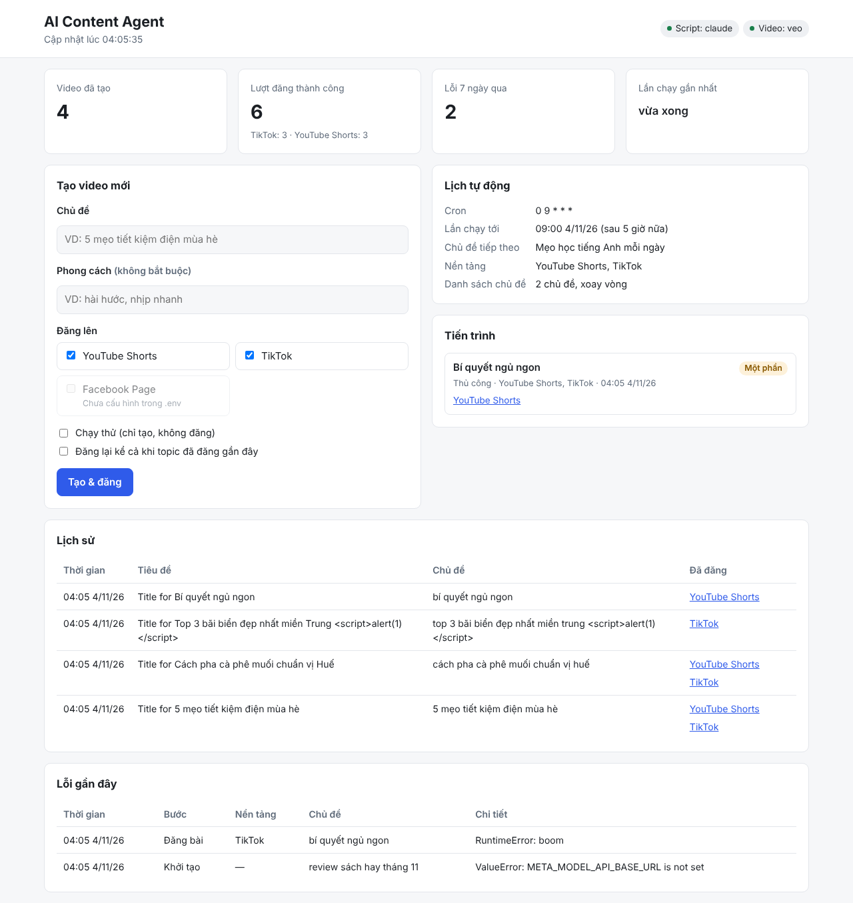

# ai-content-agent

Agent tự động hóa toàn bộ chuỗi: **sinh ý tưởng/script → tạo video → đăng
lên nhiều nền tảng mạng xã hội**, dùng GPT, Claude, Google AI (Gemini/Veo)
và Meta Muse làm engine chính, đăng lên **YouTube Shorts, TikTok và
Facebook Page**.

Kiến trúc được thiết kế để **thêm nền tảng mới chỉ cần viết 1 class**,
không phải sửa lại pipeline. Có **dashboard web** (mở bằng trình duyệt)
để bấm tạo video, theo dõi tiến trình, xem lịch sử, lịch tự động và log
lỗi.



## Kiến trúc

```
topic (string)
   │
   ▼
TextGenerator   (gpt | claude | gemini | muse)  -> ScriptResult{title, script, hashtags}
   │
   ▼
VideoGenerator  (veo)                     -> VideoResult{file_path}
   │
   ▼
Thumbnail       (ffmpeg + Pillow)         -> VideoResult.thumbnail_path
   │
   ▼
Publisher[]     (youtube | tiktok | facebook)  -> PublishResult{url}
   │
   ▼
HistoryStore    (SQLite)                  -> lưu run, lượt đăng, lỗi từng bước; chặn topic trùng
```

Dashboard web (`ai-content-agent dashboard`) = FastAPI + HTML/JS thuần,
chạy pipeline qua 1 hàng đợi background (mỗi lần 1 job để kiểm soát chi
phí API), và có thể chạy luôn lịch cron trong cùng tiến trình.

- `src/ai_content_agent/providers/` — mỗi AI engine là 1 class implement
  `TextGenerator` hoặc `VideoGenerator` (`providers/base.py`).
- `src/ai_content_agent/publishers/` — mỗi nền tảng đăng bài là 1 class
  implement `Publisher` (`publishers/base.py`).
- `src/ai_content_agent/pipeline/content_pipeline.py` — nối 3 bước lại,
  không biết chi tiết của bất kỳ provider/publisher cụ thể nào.
- `src/ai_content_agent/media/thumbnail.py` — cắt 1 frame từ video,
  crop giữa về 1280x720, phủ tiêu đề lên.
- `src/ai_content_agent/history.py` — SQLite lưu lịch sử + lỗi, chống
  đăng trùng topic trong `DEDUP_WINDOW_DAYS` ngày (chỉ tính lượt đã đăng
  thành công, nên lần đăng thất bại có thể chạy lại).
- `src/ai_content_agent/web/` — dashboard: `app.py` (API), `jobs.py`
  (hàng đợi job), `server.py` (khởi động), `static/` (giao diện).
- `src/ai_content_agent/agent.py` — đọc config, dựng pipeline cụ thể.
- `src/ai_content_agent/cli.py` — `run`, `schedule`, `history`,
  `dashboard`.

### Trạng thái từng provider/publisher

| Thành phần | Trạng thái |
|---|---|
| GPT (OpenAI) — script | hoạt động, cần `OPENAI_API_KEY` |
| Claude (Anthropic) — script | hoạt động, cần `ANTHROPIC_API_KEY` |
| Gemini (Google AI) — script | hoạt động, cần `GOOGLE_API_KEY` |
| Muse Spark (Meta) — script | hoạt động qua **Meta Model API** (public preview, chỉ developer ở Mỹ), model `muse-spark-1.1`, cần `META_MODEL_API_KEY` + `META_MODEL_API_BASE_URL` (lấy base URL từ [dev.meta.ai/docs](https://dev.meta.ai/docs)) |
| Veo (Google AI Pro) — video | hoạt động nếu tài khoản có quyền Veo; tên model/tham số nên verify lại với docs hiện tại vì Google đổi khá thường xuyên |
| Muse Video (Meta) — video | **chưa có** — tính đến 10/2026 Meta chưa mở API chính thức cho Muse Video. Chọn `VIDEO_PROVIDER=muse` sẽ báo lỗi ngay khi khởi tạo (không tốn tiền sinh script trước). Các dịch vụ bên thứ ba bọc gói muse.ai không chính thức nên không được hỗ trợ |
| YouTube — publish | hoạt động, cần OAuth app (xem dưới) |
| TikTok — publish | hoạt động theo Content Posting API (Direct Post, tự chia chunk cho video > 64MB), cần app được cấp quyền `video.publish`. **Trước khi TikTok audit app, bài chỉ đăng được ở chế độ riêng tư** (`TIKTOK_PRIVACY_LEVEL=SELF_ONLY`) |
| Facebook Page — publish | hoạt động, cần Page access token dài hạn; trả về link `facebook.com/watch` |
| Thumbnail tự động | hoạt động, cần `ffmpeg` trên máy; YouTube chỉ nhận custom thumbnail nếu kênh đã xác minh số điện thoại (không xác minh thì bỏ qua, video vẫn đăng bình thường) |
| Chống đăng trùng topic | hoạt động (SQLite, không cần cài thêm gì) |

## Cài đặt

Cần Python 3.11+ và `ffmpeg` (cho bước tạo thumbnail):

```bash
# macOS: brew install ffmpeg   |   Ubuntu: sudo apt install ffmpeg
```

```bash
cd ai-content-agent
python -m venv .venv && source .venv/bin/activate
pip install -e ".[dev]"
cp .env.example .env   # rồi điền API key
```

## Chạy thử (không đăng, chỉ sinh nội dung)

```bash
python scripts/run_once.py "5 mẹo tiết kiệm điện mùa hè" --dry-run
```

## Chạy thật, đăng lên 1 hoặc nhiều nền tảng

```bash
ai-content-agent run "5 mẹo tiết kiệm điện mùa hè" --platform youtube --platform tiktok
```

Topic đã đăng trong 30 ngày gần nhất sẽ tự bị bỏ qua (so sánh không phân
biệt hoa thường/khoảng trắng). Muốn đăng lại vẫn được:

```bash
ai-content-agent run "5 mẹo tiết kiệm điện mùa hè" --platform youtube --force
```

## Xem lịch sử đã sinh/đăng

```bash
ai-content-agent history --limit 20
```

## Chạy theo lịch (cron, trong 1 tiến trình dài hạn)

```bash
ai-content-agent schedule "Chủ đề 1" "Chủ đề 2" --cron "0 9 * * *" --platform youtube
```

## Dashboard web

```bash
ai-content-agent dashboard
```

Terminal sẽ in ra link dạng `http://127.0.0.1:8000/#token=...` — mở link
đó là đăng nhập luôn (token được lưu trong trình duyệt). Muốn token cố
định thì đặt `DASHBOARD_TOKEN` trong `.env`.

Chạy dashboard kèm lịch tự động (lịch chạy ngay trong tiến trình
dashboard, xoay vòng qua danh sách chủ đề):

```bash
ai-content-agent dashboard --cron "0 9 * * *" --topic "Chủ đề 1" --topic "Chủ đề 2" --platform youtube --platform tiktok
```

Dashboard có:
- Thống kê: số video, lượt đăng theo nền tảng, lỗi 7 ngày qua.
- Form tạo video: chọn nền tảng (nền tảng chưa cấu hình bị khóa kèm lý
  do), chạy thử, đăng lại topic trùng.
- Tiến trình job realtime (đang chờ → đang chạy → thành công / một
  phần / bỏ qua / thất bại).
- Lịch tự động: cron, lần chạy tới, chủ đề tiếp theo.
- Lịch sử kèm link bài đã đăng, và log lỗi theo từng bước (khởi tạo,
  viết script, tạo video, thumbnail, đăng bài).

**Bảo mật:** mọi API của dashboard đều yêu cầu token, kể cả trên
localhost, vì dashboard có thể đăng bài thật lên tài khoản của bạn. Mặc
định chỉ nghe trên `127.0.0.1`. Nếu mở ra mạng ngoài (`--host 0.0.0.0`),
hãy đặt sau reverse proxy có HTTPS để token không bị gửi dạng plain text.

## Setup từng nền tảng

### YouTube
1. Tạo project trên Google Cloud Console, enable **YouTube Data API v3**.
2. Tạo OAuth client ID (loại *Desktop app*), tải `client_secret.json` về
   gốc project.
3. Lần chạy đầu sẽ mở browser để bạn consent; token được lưu vào
   `youtube_token.json` và tự refresh các lần sau.

### TikTok
1. Tạo app trên [TikTok for Developers](https://developers.tiktok.com/),
   bật sản phẩm **Content Posting API** (Direct Post).
2. Xin quyền `video.publish`.
3. Lấy access token cho tài khoản mục tiêu, bỏ vào `TIKTOK_ACCESS_TOKEN`.
4. Khi app chưa được TikTok audit, video chỉ đăng ở chế độ riêng tư
   (`TIKTOK_PRIVACY_LEVEL=SELF_ONLY`). Audit xong thì đổi thành
   `PUBLIC_TO_EVERYONE`.

### Facebook Page
1. Tạo app trên [Meta for Developers](https://developers.facebook.com/).
2. Lấy Page access token dài hạn có quyền `pages_manage_posts` và
   `pages_read_engagement`, điền `FACEBOOK_PAGE_ID` và
   `FACEBOOK_ACCESS_TOKEN`.

## Mở rộng thêm nền tảng/engine mới

1. Thêm nền tảng đăng bài (ví dụ X, LinkedIn, Pinterest):
   - Viết class mới trong `publishers/`, implement `Publisher.publish()`.
   - Đăng ký vào `PUBLISHERS` trong `publishers/__init__.py` — CLI và
     API dashboard tự nhận nền tảng mới từ đây.
   - Thêm biến môi trường vào `config.py` (+ 1 dòng trong
     `Config.status()` để dashboard biết đã cấu hình chưa), và 1 nhánh
     trong `ContentAgent._build_publishers()` để truyền credentials.
   - (Tuỳ chọn) thêm tên hiển thị vào `PLATFORM_LABELS` trong
     `web/static/app.js`.
2. Thêm AI engine mới (text hoặc video):
   - Viết class mới trong `providers/`, implement `TextGenerator` hoặc
     `VideoGenerator`.
   - Đăng ký vào `TEXT_PROVIDERS`/`VIDEO_PROVIDERS` trong
     `providers/__init__.py`, thêm nhánh trong `agent.py` để truyền key.
   - Chọn qua `TEXT_PROVIDER`/`VIDEO_PROVIDER` trong `.env`.

Không cần sửa `content_pipeline.py` cho cả hai trường hợp.

## Test

```bash
pytest
```

Test dùng provider/publisher giả — không gọi API thật (không tốn tiền,
không cần key). Bao gồm: interface compliance, pipeline end-to-end,
chống trùng topic, `--force`, dry-run, publisher lỗi không chặn
publisher khác, ghi log lỗi từng bước, parse JSON từ model (kể cả khi bọc
trong ```` ```json ````), toàn bộ API dashboard (xác thực token, trạng thái
job, validate input, không lộ secret), publisher TikTok/Facebook với HTTP
giả lập (lỗi API, upload thất bại, chia chunk), và tạo thumbnail thật bằng
ffmpeg (tự skip nếu máy không có ffmpeg).

## Roadmap

- [ ] Retry/backoff khi upload lên YouTube/TikTok/Facebook bị lỗi mạng
      tạm thời.
- [x] Thêm bước tạo thumbnail tự động.
- [x] Thêm bước lưu lịch sử đã đăng (tránh trùng topic) — SQLite đơn giản.
- [x] Xem lịch sử qua CLI (`ai-content-agent history`).
- [x] Dashboard web xem lịch đăng / log lỗi / tạo video.
- [x] Kết nối Meta Muse Spark (text) qua Meta Model API.
- [x] Tập trung 3 nền tảng YouTube, TikTok, Facebook (đã bỏ Instagram).
- [ ] Muse Video — chờ Meta mở API chính thức, rồi implement
      `MetaMuseVideoProvider.generate_video()`.
- [ ] Quản lý danh sách chủ đề cho lịch tự động ngay trên dashboard
      (hiện truyền qua `--topic` khi khởi động).
